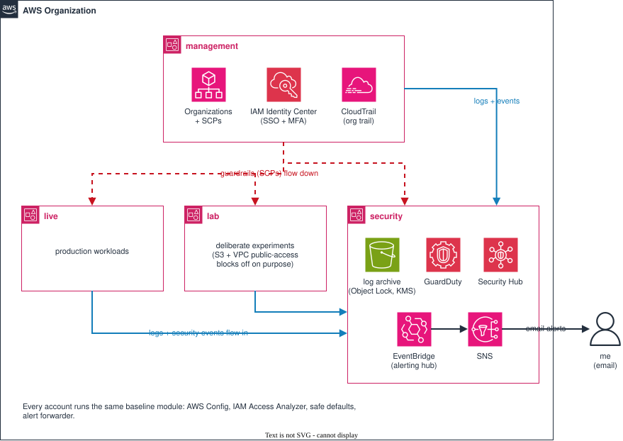

# Hardening a Multi-Account AWS Organization
A real environment, run like production

I started with a bare AWS setup: an organization with three accounts, set up
by hand in the console, with almost no security in place: no working audit
trail, no threat detection, no budget alarm, and leftovers from old
experiments. I imported the organization itself into Terraform, added a
dedicated security account, then hardened all four accounts step by step:
fixing the problems I found, adding security services and guardrails that
follow established standards, and testing that each one actually works.

## What it looks like now

Four accounts in one AWS Organization, each with one job:

- **management**: runs the organization: AWS Organizations, IAM Identity
  Center (single sign-on), billing and budgets, the organization policies
  (service control policies and others) every other account must follow,
  and the organization-wide CloudTrail trail. No workloads run here.
- **live**: production: the account for anything I actually run, whether
  that's websites, servers or databases.
- **lab**: deliberately insecure experiments. Some guardrails are relaxed on
  purpose (S3 and VPC public-access blocks), but it's logged and watched
  like every other account.
- **security**: the audit trail and the security tooling. Stores every
  account's CloudTrail and AWS Config logs (S3, KMS-encrypted, CloudTrail
  logs under Object Lock); delegated administrator for GuardDuty and
  Security Hub; hosts the alerting hub (EventBridge → SNS email).

Every account also gets the same baseline from one Terraform module: AWS
Config recording, IAM Access Analyzer, safe defaults (see Guardrails), a
forwarder that sends its security events to the alerting hub, the
access-key responder, and the read-only role the daily drift check signs
in with.

The direction matters: evidence and alerts flow *into* security, and
guardrails flow *down* from management. Someone who takes over live or lab
can't erase the logs or silence the alerts, because those have already left
the account.

## What I built

### Identity and access

Who can get in, and how?

- **One way in: single sign-on.** I sign in through IAM Identity Center with
  MFA. There are no IAM users and no long-lived access keys anywhere. I have
  two levels of access in each account: admin, and a read-only auditor for
  scanning and browsing, so day-to-day work doesn't need admin rights.
- **No hidden back doors.** I found two admin roles left over from an older
  organization. They let anyone with admin in live become admin in lab and,
  worse, in management, which controls every account. One compromised
  account could have taken over the whole organization, and the roles
  didn't show up in single sign-on at all. I deleted them, along with the
  default admin role AWS creates in new accounts. Access is SSO only.
- **Root locked down.** Member accounts have no root passwords at all (AWS
  centralized root access). The rare root-only task runs as a short-lived
  session from management, and it triggers an alert. Management's root is
  the single break-glass login: MFA, password in a password manager, and an
  MFA backup kept off the phone.
- **Limits on my own tools.** I used an AI coding assistant (Claude Code)
  throughout. It can read and edit code, but it's denied every AWS command
  and every Terraform command that touches real infrastructure; I ran all
  of those myself.

### Logs as evidence

If something goes wrong, can I prove what happened, and trust the proof?

- **One trail for everything.** One organization trail records every
  account in every region and delivers to the security account. It also
  records every read of the Terraform state files (they map the whole
  infrastructure) and of the log archive itself.
- **Logs that can't be quietly changed.** The log bucket keeps every file
  under S3 Object Lock for a year and accepts writes only from the
  organization's trail. A service control policy stops even the security
  account's admins from changing the bucket or disabling its encryption key.
  The logs are encrypted with a key I control, so reading them needs that
  key as well as access to the bucket. CloudTrail also signs an hourly
  digest, so any edited or deleted file would show up.
- **Configuration history.** AWS Config records how every resource is
  configured and when it changes, for every account, stored in security.

### Detection and alerting

Would I find out about an attack?

- **Threat detection everywhere.** GuardDuty watches every account in all
  17 regions, run from the security account, and new accounts join
  automatically. It covers regions I don't use too, because that's exactly
  where an attacker would go.
- **Continuous checks.** Security Hub runs AWS's Foundational Security Best
  Practices checks in every account. IAM Access Analyzer flags anything
  shared outside an account, including with my own other accounts (the
  same kind of trust as the back-door roles).
- **Alerts that reach me.** Findings in a console nobody watches are no
  use. Every account forwards security-relevant events to one alerting hub
  in the security account, where twelve rules email me a one-line summary:
  root sign-in or use; changes to logging, detection, alerting or the
  access-key responder; guardrail
  and single sign-on changes; new IAM users or keys; new external access;
  and GuardDuty findings of medium severity or higher. A service control
  policy stops member-account admins from switching their forwarding off,
  and a [runbook](runbook.md) says what to do for each alert.

### Guardrails

What's blocked outright, even for an admin?

Organization policies are set in management and apply to every other
account, admins included. Most are service control policies; the last
two below use newer types. They block whole categories of mistakes and
attacks instead of relying on someone noticing.

- **No leaving.** No account can leave the organization or be closed from
  inside it.
- **One region.** Member accounts can only build in us-east-1, so stolen
  credentials can't run crypto-miners in a region nobody watches. The
  read-only auditor, the security tooling and the drift check keep what
  they need everywhere.
- **Small instances only.** EC2 is limited to a few small instance types,
  so a stolen session can't launch expensive GPU machines.
- **The baseline stays on.** Account admins can't switch off default
  encryption, the public-access blocks, Config recording or Access
  Analyzer. Lab's deliberate exceptions are written into the same policy.
- **Logs and alerts protected.** Nobody in a member account can change the
  log archive, its key or the alert forwarding.
- **Only my organization reaches my data.** A resource control policy
  caps every resource policy in the member accounts: identities
  outside the organization, anonymous users included, can't use my S3
  buckets, KMS keys or roles, even if a bucket policy allows it. AWS
  services get in only when they're working for my organization, so
  nobody can point their own CloudFront at my bucket. Web sign-ins must
  be GitHub tokens from my own GitHub account, and unencrypted requests
  are refused.
- **Settings EC2 itself enforces.** A declarative policy turns the EC2
  serial console off, blocks public sharing of machine images and disk
  snapshots, and makes IMDSv2 the default in every member account.
  Unlike a service control policy, which blocks a list of API calls,
  EC2 itself holds these settings, so no member-account admin and no
  future API can change them.

Every account also has safe defaults: S3 and VPC public-access blocks
(except lab), default VPCs deleted (no network exists unless I build one),
encrypted disks, IMDSv2 for new instances, no public sharing of disk
snapshots or SSM documents, and an opt-out of AWS using my data to train
AI services, locked so no account can turn it back on.

### Changes and drift

Is every change checked, and would I notice one I didn't make?

- **Checks on every push.** Every commit is checked automatically:
  Terraform formatting, Checkov's security checks on the code, and a
  gitleaks scan of the whole git history for secrets. These checks need
  no AWS access.
- **A daily drift check.** Every day, GitHub runs `terraform plan` in all
  four accounts and compares AWS with the code. Any difference, such as a
  change made in the console, turns the run red and emails me. It signs
  in with a read-only role through GitHub's OIDC, so there are no stored
  keys; only the main branch of my private working repository can use
  the role, and a service control policy stops member-account admins
  from changing it.
- **Resources outside the code.** `plan` only sees what Terraform
  manages, so the same job also asks AWS Config for every resource
  without my `ManagedBy = terraform` tag and compares the list with a
  reviewed list of known exceptions, mostly AWS's own defaults. Anything
  new turns the run red. Reviewing that list turned up one more leftover
  from an old experiment, which I deleted.
- **Pinned, and kept up to date.** Third-party actions are pinned to
  exact commits, so a hijacked release tag can't change what runs;
  Dependabot proposes updates weekly, only for releases at least a week
  old.
- **The pipeline never applies.** It checks, but it never changes
  anything. A pipeline that applies would need admin rights over the
  whole organization without MFA, which would make it the most valuable
  target in the setup. I apply from my laptop, with MFA.

### Respond and recover

If someone gets in anyway, can I stop them and get back to normal?

- **No way to stay in.** A stolen single sign-on session dies within an
  hour, so an attacker's first move is a way back in that doesn't
  expire: an IAM user or an access key. A service control policy blocks
  creating either in member accounts. Policies can't reach management,
  so every account also runs a small function that switches off any new
  access key within seconds, keeping it as evidence.
- **The responder can't be switched off.** Disabling that function would
  be the next move. A service control policy locks its trigger, code and
  role in member accounts, and changes to it email me, as do blocked
  attempts to change the function.
- **One move to freeze an account.** A new password doesn't end a
  session that's already stolen. Moving the account into a quarantine
  OU does: a deny-everything policy stops every request within a minute,
  except the alert forwarding and the read-only auditor I investigate
  with.
- **State that can't be wiped.** The Terraform state files map
  everything I run. Versioning keeps old copies, but an admin can delete
  versions for good, so every new version is locked under S3 Object
  Lock in compliance mode for a year: nobody, root included, can delete
  one early. A bad or malicious write can always be rolled back.
- **Locked out of my own bucket.** An admin can set a bucket policy that
  denies everyone, me included, and only the account's root can remove
  it. Member accounts have no root passwords, so the unlock runs as a
  short-lived root session from management, and it raises two alerts:
  the request and what root did.
- **Rebuild from code.** The website's resources reference each other in
  the code, so if its CloudFront distribution were deleted, one apply
  would recreate it and rewire everything that points at it. The two
  steps outside Terraform (redeploying the files and updating the
  deploy's distribution ID) are one command each.

### Cost

Would a forgotten resource or a crypto-miner surprise me on the bill?

- **A budget that alerts.** A $10 monthly budget emails me at half, at
  the full amount, and when the forecast says I'll go over. It has already
  paid off: the halfway alert arrived mid-month and led me to a forgotten
  WAF web ACL (firewall rules) billing about $5 a month on a disabled
  CloudFront distribution. I deleted it.
- **Anomaly alerts at my scale.** AWS's default cost-anomaly alert only
  fired for spikes of at least $100 and 40% above expected, which would
  never happen at this budget. It now fires at $5, half the monthly
  budget.

## Results

- **60 findings:** 1 critical, 6 high, 11 medium, 23 low and 19
  informational. Every critical, high and medium finding is fixed. The
  critical one, a path from one compromised account to the whole
  organization, I found by reviewing the roles myself, before running any
  scanner.
- **Scanners as a second opinion** (Prowler, same version and settings
  before and after; us-east-1, where everything runs): failed checks down
  by a third (402 → 271), high-severity failures halved (79 → 39), and 47
  checks fixed completely.
- **Every remaining failure is explained.** Most of the 271 are deliberate
  decisions with a written reason (for example, EventBridge alerts instead
  of CIS's CloudWatch alarms) or checks for services I don't use; a few are
  scanner errors I traced to Prowler's own code. The 7 critical ones: my
  admin role's AdministratorAccess (4), app-based root MFA (1), scanner
  errors (2) — see Limits.
- **Code:** Checkov reports nothing unexplained: 168 checks pass, none
  fail, and each of the 62 skipped checks carries its reason in the code.
  All but one are accepted trade-offs; the one known gap (CloudFront
  access logging on my website) is marked as deferred. gitleaks finds no
  secrets in the full git history. Both run on every push.

## Limits and trade-offs

What I deliberately didn't do, and why:

- **Management is the one account guardrails can't reach.** Service
  control and resource control policies never apply to it, so nothing
  runs there, it's reached only through single sign-on with MFA, and
  every guardrail change sends an alert.
- **Admin access is broad.** My admin role uses AWS's AdministratorAccess
  policy; single sign-on, MFA and short sessions limit the risk. A
  narrower admin role is the first thing I'd tighten with more people.
- **Root uses app-based MFA**, not a hardware key. It's the break-glass
  login only, and any use triggers an alert.
- **One security account** instead of AWS's recommended separate
  log-archive and security-tooling accounts. At this size the split adds
  overhead without much benefit; it's the first thing I'd change as the
  organization grows.
- **One region.** The baseline covers us-east-1 only; the other regions
  are locked off and watched by GuardDuty instead of configured.
- **Alerts are email only.** No paging, ticketing or SIEM, and
  investigating means reading the logs directly.
- **CI checks the code after the fact.** On GitHub's free plan a private
  repository can't require checks before a change lands, and I apply
  from my laptop before pushing. So CI catches mistakes in the code; the
  plan I review before every apply is the real gate.
- **A tag isn't proof.** Anyone who can create a resource can also add
  `ManagedBy = terraform`, so the untagged check finds forgotten or
  careless resources, not a careful attacker. CloudTrail and the alerts
  cover that.
- **Daily, not real time.** Drift and resources outside the code show up
  within a day; the alerts cover the most sensitive changes in minutes.
  The drift check only emails on failure, so if it ever stopped running
  I'd notice in the monthly alert test. Config's view covers us-east-1,
  where the region lock keeps member accounts; management isn't
  region-locked.
- **The data perimeter has edges.** It doesn't cover the management
  account's resources or AWS-managed keys, and I couldn't test the
  rules against a real outside organization or GitHub account; those
  follow AWS's published pattern, checked by review.
- **VPC and S3 public access aren't in a declarative policy.** They're
  set by Terraform and guarded by a service control policy; a third
  layer couldn't be tested on its own and risked lab's deliberate
  exception.
- **Management can't be frozen.** It can't be moved into quarantine,
  its own admin could switch its key responder off (that alerts), and
  unlocking its buckets takes the root sign-in. There, break-glass is
  the response.
- **Some recovery is untested.** Quarantine was drilled on lab only;
  live and security should keep their AWS-run parts working (the
  website, log delivery, the alert hub), but I haven't proven it.
  Rebuilding the website would mean taking the real site down, so only
  the redeploy step is tested.
- **State protection has edges.** Each state version is locked for a
  year from when it was written, so an account untouched for over a
  year has an unlocked current version, and nothing can be removed
  early, even by me. Every apply writes state, so writes don't alert:
  an overwrite shows up in the daily drift check instead.
- **A few seconds' window.** A new access key works for about four
  seconds before the responder switches it off.
- **The AI assistant's limits stop mistakes, not attackers.** The rules
  match command text, so a determined attacker could get around them.
  Separate read-only credentials for the assistant would be the real
  boundary.

## How I tested it

### Identity and access
- Read-only auditor: reads every account's configuration (the scanners ran
  with it), but downloading a Terraform state file returns 403.
- Break-glass: a real root session from management triggered an alert
  email. Root can't be used quietly.
- Assistant: its attempts to run AWS or `terraform apply`, including
  disguised variants, were denied.

### Logs as evidence
- Tamper protection: a security-account admin trying to change the log
  bucket, and separately the key's policy, was denied by the service
  control policy.
- Integrity: the signed digests check out for all 4 accounts: 6,246 of
  6,246 log files valid since the trail started, and still valid after the
  switch to the new key.

### Detection and alerting
- Every test ran through the live alerting chain, end to end: a real IAM
  user created in lab, a GuardDuty sample finding generated in a region I
  don't use, and a lab admin trying to remove the forwarding. Each one
  reached my inbox; the last was also blocked.
- Testing found two gaps, both fixed: anyone with an alert email could
  unsubscribe me (now needs an AWS login), and a blocked attempt read like
  a real change (alerts now show the error code).

### Guardrails
- Region lock: a lab admin in Ireland was denied; the read-only auditor
  there was allowed; a GuardDuty alert from Ireland still arrived.
- Instance types: launching a GPU instance was denied, a small one was
  allowed (dry runs).
- Baseline: a live admin trying to turn off default encryption, or to
  change S3 public-access settings, was denied; lab's exception still
  worked.
- Data perimeter: a deliberately public test bucket in lab served a file
  to anyone, over HTTPS and plain HTTP; with the policy attached, both
  were refused while my own access still worked. Rolled out to live and
  security one at a time, checking what relies on AWS services or
  GitHub: the website, its deploy, the drift check, and log delivery
  from CloudTrail and Config.
- Declarative policy: a lab admin trying to turn the serial console on
  or allow public machine images got a "declarative policy violation";
  all three accounts report the settings as managed by the policy.

### Changes and drift
- Drift: a policy that existed in AWS but not yet in the code turned the
  run red, naming that exact policy; after pushing the code, all four
  accounts went green.
- Resources outside the code: an untagged SNS topic created in lab turned
  the run red and named it; after deleting it, green again.
- Data source: before relying on it, I checked it against known facts.
  Resource Explorer still listed a role deleted the day before, so I used
  AWS Config, which was current.
- Role lock: a lab admin trying to change the drift role was denied by
  the service control policy.

### Respond and recover
- No users or keys: a lab admin trying to create an IAM user, a password
  or an access key was denied, and each attempt still sent an alert.
- Responder: an access key created in management was switched off about
  four seconds later. A lab admin trying to disable its trigger, stop
  the function or strip its role was denied, and blocked attempts alert.
- Quarantine: moving lab into the quarantine OU stopped an admin session
  that was already open, while alerts kept arriving and the read-only
  auditor still worked; moving it back restored access.
- Incident drill: from a staged 3 a.m. alert to release, using only the
  runbook. It found three gaps: placeholder commands slowed me down, the
  runbook thought in single accounts while a stolen identity reaches all
  four, and CloudTrail's event history lagged the alert by over ten
  minutes. The first two are fixed; the third is now in the runbook.
- State: a lab admin deleting a locked state version was refused. I
  overwrote lab's state with junk, `terraform plan` failed, and restoring
  the last good version brought it back to "No changes".
- Locked bucket: a lab bucket with a deny-everyone policy refused my
  admin; a short-lived root session from management removed the policy,
  and both alerts arrived.
- Rebuild: the website's manual redeploy works (the full rebuild is
  untested, see Limits).

## What's in this repo

- `infra/`: all the Terraform, one folder per account (`management`,
  `security`, `live`, `lab`) plus shared `modules/`; each folder is
  applied on its own. `modules/account-baseline` is the set of defaults
  every account gets.
- `infra/modules/account-baseline/lambda/`: the access-key responder's
  Python code.
- Account IDs and emails aren't in the code: each folder reads them from
  a private `terraform.tfvars` (and the state bucket from `backend.hcl`).
  The `.example` files show the shape.
- `infra/live` also runs my personal website (S3 + CloudFront, deployed
  from GitHub without stored keys).
- [`runbook.md`](runbook.md): what I do when each alert arrives, and how
  to contain an incident and recover.
- `ci/`: the GitHub Actions workflows and Dependabot config as they run
  in my private working repository (kept out of `.github/` so they
  don't run here). The reviewed untagged-resource lists stay private:
  they contain account IDs.
